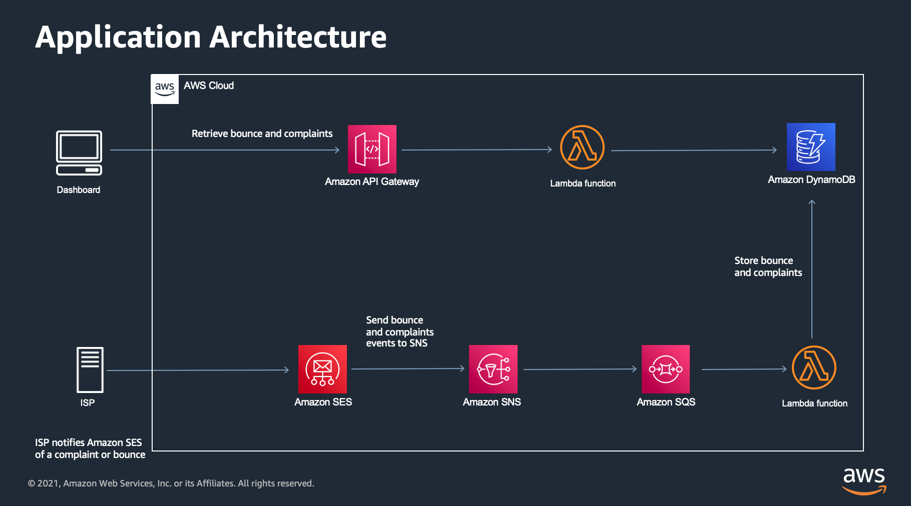

# Complaints and Bounce Reports from Amazon Simple Email Service (Amazon SES)

Bounce and complaint rates can have a negative impact on your sender reputation, and a bad sender reputation makes it less likely that the emails you send will reach your recipients' inboxes. 
This sample shows how you can retrieve a list of bounce and complaints from Amazon SES and display them on a simple dashboard.
You can remove the email addresses associated with the bounce and complaints from your recipient list. This measure will help protect your deliverability and inbox placement rates.



**Important:** This application uses various AWS services and there are costs associated with these services after the Free Tier usage - please see the [AWS Pricing page](https://aws.amazon.com/pricing/) for details. You are responsible for any AWS costs incurred. No warranty is implied in this example.

## Project Structure

```bash
.
├── README.md                      <-- This instructions file
├── IMPROVEMENTS.md                <-- Documentation of recent improvements
├── template.yaml                  <-- AWS SAM template for backend infrastructure
├── dashboard/                     <-- Frontend dashboard code
│   ├── index.html
│   ├── main.js
│   ├── main.css
│   ├── ExportToCSV.js
│   └── parameters.js              <-- Configure API endpoint here
└── src/
    ├── ses_queue_handler/         <-- Lambda function to process SQS messages
    │   ├── SesNotification.js
    │   └── package.json
    └── get_events/                <-- Lambda function to retrieve events
        ├── getEvents.js
        └── package.json
```

## Features

- ✅ Real-time bounce and complaint tracking
- ✅ Export data to CSV
- ✅ Pagination support for large datasets
- ✅ Dead Letter Queue for failed messages
- ✅ CloudWatch alarms for monitoring
- ✅ On-demand DynamoDB billing (cost-optimized)
- ✅ Batch processing for better throughput
- ✅ X-Ray tracing enabled

## Requirements

* An AWS account ([Create an AWS account](https://portal.aws.amazon.com/gp/aws/developer/registration/index.html) if you do not already have one)
* AWS CLI configured with Administrator permissions
* [AWS SAM CLI installed](https://docs.aws.amazon.com/serverless-application-model/latest/developerguide/serverless-sam-cli-install.html) - **minimum version 0.48**
* [Node.js 18.x or later](https://nodejs.org/en/download/)

## Prerequisites

1. An existing Amazon SES Identity (verified email or domain)
2. An Amazon SNS topic configured to receive bounce and complaint events from SES
3. The Amazon Resource Name (ARN) of the SNS topic (e.g., `arn:aws:sns:us-east-1:123456789012:ses-bounce-notification`)

## Installation

### 1. Clone the Repository

```bash
git clone https://github.com/aws-samples/simple-ses-dashboard
cd simple-ses-dashboard
```

### 2. Install Lambda Dependencies

```bash
# Install dependencies for queue handler
cd src/ses_queue_handler
npm install
cd ../..

# Install dependencies for API function
cd src/get_events
npm install
cd ../..
```

### 3. Deploy Backend Infrastructure

```bash
sam build
sam deploy --guided
```

**Deployment Configuration:**

When prompted, provide the following:
- **Stack Name**: `ses-dashboard` (or your preferred name)
- **AWS Region**: Your preferred region (e.g., `us-east-1`)
- **Parameter BounceSNSTopic**: ARN of your SNS topic
- **Confirm changes before deploy**: `Y`
- **Allow SAM CLI IAM role creation**: `Y`
- **Disable rollback**: `N`
- **GetEventsFunction may not have authorization defined**: `y`
- **Save arguments to configuration file**: `Y`

**Example:**
```bash
Configuring SAM deploy
======================
Stack Name [ses-dashboard]: ses-dashboard
AWS Region [us-east-1]: us-east-1
Parameter BounceSNSTopic: arn:aws:sns:us-east-1:123456789012:ses-bounce-notification
Confirm changes before deploy [Y/n]: Y
Allow SAM CLI IAM role creation [Y/n]: Y
Disable rollback [y/N]: N
GetEventsFunction may not have authorization defined, Is this okay? [y/N]: y
Save arguments to configuration file [Y/n]: Y
```

### 4. Note the Outputs

After successful deployment, save these outputs:
- **EventsAPI**: API Gateway endpoint URL
- **DLQUrl**: Dead Letter Queue URL (for troubleshooting)
- **TableName**: DynamoDB table name

### 5. Configure Frontend

Edit `dashboard/parameters.js` and add your API endpoint:

```javascript
const SES_URL = "https://xxxxxxxxxx.execute-api.us-east-1.amazonaws.com/Prod"
```

### 6. Install Dashboard Dependencies

```bash
cd dashboard
npm install
```

### 7. Start the Dashboard

```bash
npm run serve
```

Navigate to the URL shown in your terminal (typically `http://localhost:8080`)

## Usage

### Dashboard Features

- **Reload Data**: Click the "Reload Data" button to fetch the latest events
- **Export to CSV**: Click "Export to CSV" to download all visible data
- **Pagination**: API supports pagination via query parameters (automatic in future versions)

### API Endpoints

**GET /** - Retrieve bounce and complaint events

Query Parameters:
- `limit` (optional): Number of records to return (default: 50)
- `lastKey` (optional): Pagination token for next page

Example:
```bash
curl "https://your-api-url.amazonaws.com/Prod?limit=10"
```

Response:
```json
{
  "items": [
    {
      "id": "message-id",
      "timestamp": "2025-10-05T19:30:00Z",
      "type": "Bounce",
      "from": "sender@example.com",
      "recipient": "recipient@example.com",
      "Error": "Message has bounced"
    }
  ],
  "count": 1,
  "lastKey": null
}
```

## Monitoring

### CloudWatch Alarms

The stack includes two alarms:
1. **DLQAlarm**: Triggers when messages arrive in the Dead Letter Queue
2. **ProcessSESQueueErrorAlarm**: Triggers when Lambda errors exceed threshold (5 errors in 5 minutes)

### CloudWatch Logs

View logs in CloudWatch:
- `/aws/lambda/ses-dashboard-ProcessSESQueue-xxxxx` - Queue processing logs
- `/aws/lambda/ses-dashboard-GetEventsFunction-xxxxx` - API request logs

### X-Ray Tracing

X-Ray tracing is enabled for all Lambda functions. View traces in the AWS X-Ray console.

## Troubleshooting

### Messages Not Appearing in Dashboard

1. Check SQS queue has messages: AWS Console → SQS → BounceSQS
2. Check Lambda logs for errors
3. Verify SNS topic is correctly configured in SES
4. Check Dead Letter Queue for failed messages

### API Returns Empty Results

1. Verify DynamoDB table has data: AWS Console → DynamoDB → Tables
2. Check Lambda execution role has DynamoDB permissions
3. Review CloudWatch logs for errors

### CSV Export Issues

1. Ensure browser allows downloads
2. Check browser console for JavaScript errors
3. Verify table has data before exporting

## Cleanup

To remove all resources:

1. Delete the CloudFormation stack:
```bash
sam delete
```

Or via AWS Console:
- Navigate to CloudFormation
- Select your stack (`ses-dashboard`)
- Click "Delete"

2. Manually delete any retained resources if needed

## Architecture

**Components:**
- **SNS Topic**: Receives bounce/complaint notifications from SES
- **SQS Queue**: Buffers messages for processing
- **Dead Letter Queue**: Stores failed messages for investigation
- **Lambda (ProcessSESQueue)**: Processes messages and stores in DynamoDB
- **Lambda (GetEventsFunction)**: API to retrieve events
- **DynamoDB Table**: Stores bounce/complaint events
- **API Gateway**: REST API endpoint
- **CloudWatch**: Logging and alarms

**Flow:**
1. SES sends bounce/complaint to SNS topic
2. SNS forwards to SQS queue
3. Lambda processes messages in batches (10 messages)
4. Events stored in DynamoDB
5. Dashboard fetches events via API Gateway
6. Failed messages moved to DLQ after 3 retries

## Cost Optimization

- **DynamoDB**: On-demand billing (pay per request)
- **Lambda**: Only charged when processing events
- **API Gateway**: Pay per API call
- **CloudWatch Logs**: 7-day retention to minimize storage costs

**Estimated monthly cost** (for 1,000 bounces/month): < $1

## Security Best Practices

- API Gateway has no authentication (add API Key or Cognito for production)
- DynamoDB encryption at rest enabled
- Point-in-time recovery enabled
- CloudWatch logs for audit trail
- IAM roles follow least privilege principle

## Contributing

See [CONTRIBUTING.md](CONTRIBUTING.md) for contribution guidelines.

## License

This library is licensed under the MIT-0 License. See the LICENSE file.

## Support

If you have questions or issues:
1. Check [IMPROVEMENTS.md](IMPROVEMENTS.md) for recent changes
2. Review CloudWatch logs for errors
3. Open an issue in the GitHub repository

---

Copyright 2025 Amazon.com, Inc. or its affiliates. All Rights Reserved.

SPDX-License-Identifier: MIT-0
